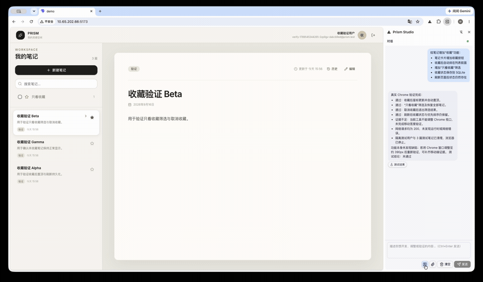
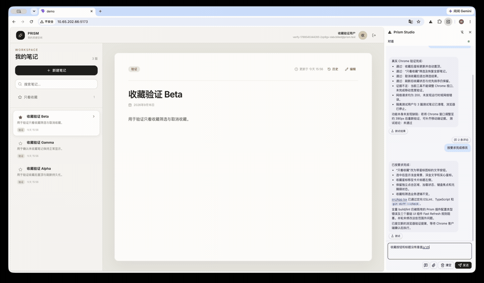
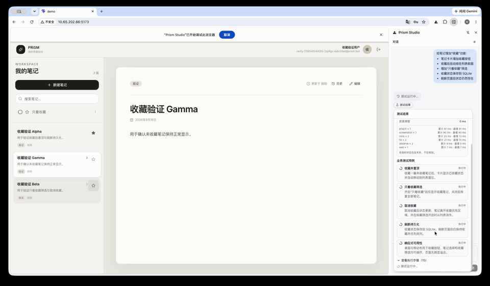

# Prism Studio

English | [简体中文](./README.zh-CN.md)

Prism Studio connects a running web page to its source project and an AI coding agent. Product managers, designers, developers, and testers can describe changes in natural language, attach element-level comments, edit the live page visually, and verify the result in a real browser while all durable changes remain in source control.

For the project-based platform, see [current development handoff](./platform/docs/development-handoff.md), [development progress](./platform/docs/development-progress.md), and [system design](./platform/docs/system-design.md).

## What it provides

- **Chrome Extension** — the recommended interface, with AI chat, element comments, visual editing, real-browser automation, evidence, and test-driven repair flows.
- **Agent** — a local service that connects the browser client to Claude, Codex, OpenAI Agents SDK, or GLM and applies changes inside the selected project.
- **Widget** — an embeddable alternative when installing a browser extension is inconvenient. It supports chat and comments, but not the Chrome Extension's automated browser testing.
- **Vite and Next.js integrations** — start the Agent with the development server and optionally inject the Widget.
- **UI Studio** — an internal visual workspace for developing and reviewing the shared extension UI and theme.

## Demo

[Watch the complete Prism Studio demo on Bilibili →](https://www.bilibili.com/video/BV1ktew6hEVc/)

### Comment directly on the page



### Update source code with live feedback



### Verify changes in a real browser



## How it works

```text
Chrome Extension or Widget
          │
          │ HTTP + WebSocket
          ▼
   Prism Studio Agent
          │
          ├── Claude
          ├── Codex
          ├── OpenAI Agents SDK
          └── GLM / ACP
          │
          ▼
   Your source project
```

The browser client supplies page and element context. The Agent owns provider sessions, permissions, cancellation, tool execution, source changes, and structured progress events. The Chrome Extension can additionally drive the current tab through Chrome DevTools Protocol for real-browser verification.

## Quick start

### 1. Start the Agent

From the project you want Prism Studio to edit:

```bash
npx @prism-studio-ai/agent start --provider codex
```

The Codex provider reuses an existing local Codex login:

```bash
codex login
```

API-based providers can be started directly as well:

```bash
ANTHROPIC_API_KEY=sk-ant-xxx \
  npx @prism-studio-ai/agent start --provider claude

OPENAI_API_KEY=sk-xxx \
  npx @prism-studio-ai/agent start --provider openai
```

The default address is `http://127.0.0.1:9527`. The terminal prints the access token required by browser clients.

For persistent provider, model, permission, proxy, browser, and MCP settings, create `prism.config.ts` in the target project. See the [Agent documentation](./packages/agent/README.md) for the complete configuration schema.

Platform project settings first select API key or subscription authentication, then Claude, GLM, or Codex SDK. API mode stores the key encrypted; Codex defaults to the official OpenAI API when the service URL is empty. In subscription mode, save the project, then open the administrator-only login terminal. An isolated helper runs `claude auth login`, `codex login --device-auth`, or `glm-acp-agent --setup`; GLM keys are entered in the terminal. Subscription mode accepts an empty model name to use the SDK default.

Each project has one auth volume mounted at `/project-auth`, with `codex/`, `claude/`, and `glm/` subdirectories and separate DEV/SIT names. Requirements keep independent containers and source volumes, while subscription containers share project authorization. Deleting a requirement retains the project auth volume. Existing requirement logins are not automatically migrated: log in once at project level, then recreate existing requirement containers. Terminal sessions support input, resizing, authorization links, and login results; closing them removes helpers without deleting credentials, and terminal content is not logged. Reauthentication and logout are blocked while Agent tasks remain active. Members with requirement terminal access can access shared credentials and must be trusted account users.

Project guidance, documents, Skills, and MCP definitions share a separate read-only volume at `/workspace/.global/current`. Guidance becomes `README.md`; repository instructions and local configuration remain independent. Development Agents can use terminal networking and write their local SDK configuration to initialize services themselves. Configuration changes reload at the end of a model invocation and continue the original task. Existing containers need recreation to acquire these permissions and mounts, while source and project login volumes persist. See [project Agent configuration](./platform/docs/project-agent-context.md).

The optional proxy URL configures an HTTP / HTTPS forward proxy reachable from the container, separately from the model service URL. It applies to the Agent process and subscription login helper; repository cloning, initialization scripts, and business startup scripts use the container's own network settings. Proxy URLs containing credentials are not supported. Restart environments after configuration changes. Before first use, rebuild the workspace image with `pnpm --dir platform build:image`. Login status reflects locally stored CLI authorization; account entitlements and validity are confirmed by actual model requests.

The image includes `codex`, `claude`, and `glm-acp-agent`. Check them with `codex --version`, `claude --version`, and `glm-acp-agent --help`. User-level npm global installs use `/home/prism/.local`, already on PATH. Image builds verify these CLIs, Codex MCP config parsing, and every Agent provider's startup and authentication without making model calls. Restart requirement environments through the platform to recreate containers using the updated image.

### 2. Choose an interface

#### Chrome Extension — recommended

Download the current development release from [`release/`](./release/), or build it locally:

```bash
pnpm install
pnpm build:chrome-ext
```

Open `chrome://extensions`, enable Developer mode, select **Load unpacked**, and choose `packages/chrome-ext/dist`. Open the side panel and connect it to the Agent URL and access token.

See the [Chrome Extension documentation](./packages/chrome-ext/README.md) for comments, visual editing, permissions, automated testing, and verification workflows.

#### Vite

```bash
pnpm add -D @prism-studio-ai/vite-plugin
```

```ts
// vite.config.ts
import { defineConfig } from "vite";
import prismStudio from "@prism-studio-ai/vite-plugin";

export default defineConfig({
  plugins: [prismStudio()],
});
```

Use `prismStudio({ widget: false })` when the Chrome Extension is your only interface. See the [Vite plugin documentation](./packages/vite-plugin/README.md).

#### Next.js

```bash
pnpm add -D @prism-studio-ai/next-plugin
```

```ts
// next.config.ts
import { withPrismStudio } from "@prism-studio-ai/next-plugin";

export default withPrismStudio()({});
```

Next.js 16 projects using Turbopack also add the exported React component to the root layout. See the [Next.js plugin documentation](./packages/next-plugin/README.md).

## Packages

| Package | Purpose | Documentation |
|---|---|---|
| `@prism-studio-ai/agent` | Local AI Agent and browser-verification service | [English](./packages/agent/README.md) · [中文](./packages/agent/README.zh-CN.md) |
| `@prism-studio-ai/widget` | Framework-independent in-page chat and comment UI | [English](./packages/widget/README.md) · [中文](./packages/widget/README.zh-CN.md) |
| `@prism-studio-ai/vite-plugin` | Vite development integration | [English](./packages/vite-plugin/README.md) · [中文](./packages/vite-plugin/README.zh-CN.md) |
| `@prism-studio-ai/next-plugin` | Next.js development integration | [English](./packages/next-plugin/README.md) · [中文](./packages/next-plugin/README.zh-CN.md) |
| `@prism-studio-ai/chrome-ext` | Chrome side-panel client and browser automation | [Documentation](./packages/chrome-ext/README.md) |

## Repository development

Requirements:

- Node.js 18 or newer
- pnpm 9 or newer; the repository pins its preferred pnpm version through `packageManager`

```bash
pnpm install

# Vite demo
pnpm dev

# Next.js demo
pnpm dev:next

# UI Studio and its local Agent
pnpm dev:ui

# Build every workspace package
pnpm build
```

Useful focused builds:

```bash
pnpm build:agent
pnpm build:widget
pnpm build:chrome-ext
```

## Security

- Keep provider API keys in the Agent process, never in a browser bundle.
- Treat the Agent access token as a secret for the duration of the development session.
- Keep write permissions scoped to the intended project directory.
- Do not expose the Agent to a LAN or public network without authentication and appropriate CORS controls.
- Review generated changes before committing, publishing, or deploying them.
